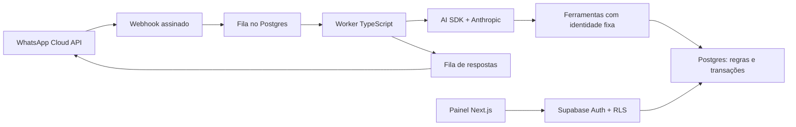

# Ateliê — agenda e atendimento do salão

Primeira implementação do projeto **Sistema de Atendimento WhatsApp com IA — Salão de Unhas**. Next.js, React, TypeScript, Tailwind, Supabase SSR, Vercel AI SDK e FullCalendar estão integrados ao código. Não é necessário clonar os repositórios dessas bibliotecas.

## Executar a demonstração

Requisitos: Node.js 22+ e npm. Validado com Node 24.

```bash
cd /workspace/TESTES
npm ci
APP_MODE=demo npm run dev
```

A demonstração oferece agenda diária/semanal/mensal, filtros por profissional, criação e remarcação de horários, cancelamento/conclusão, cadastro de serviços, conversa simulada, transferência entre IA/equipe e pausa global. Dados fictícios e alterações ficam no `localStorage` do navegador e são restaurados a cada novo dia. Não use dados reais nesse modo. Em Configurações, “Restaurar exemplos” limpa as alterações.

O modo demonstração **não chama IA, banco externo ou WhatsApp**. O envio apenas adiciona uma mensagem fictícia. Os endpoints de escrita e webhook ficam bloqueados. Expediente demonstrativo: segunda a sábado, das 9h às 18h, em Brasília.

## Conectar os serviços reais

### 1. Supabase

1. Crie um projeto Supabase exclusivo para o aplicativo.
2. Desative cadastro público em Authentication e crie usuários individuais da equipe.
3. Execute **uma vez**, no SQL Editor, `supabase/migrations/202610150001_initial.sql`. É uma migração versionada, não um script para reaplicar sobre tabelas existentes.
4. Opcionalmente, execute `supabase/seed.sql`: três profissionais, serviços e expedientes de exemplo. O seed pode ser repetido; substitua os exemplos antes de operar.
5. Vincule os UUIDs de Authentication em `team_members`: `role='admin'` para a dona; `role='employee'` e `professional_id` para cada funcionária. Use o SQL Editor ou Table Editor administrativo. A aplicação não permite autopromoção.
6. Cadastre expedientes em `working_hours` e folgas em `blocks`. Domingo=0, segunda=1, até sábado=6. Manhã e tarde podem ser duas linhas. Não há intervalo automático entre serviços nesta versão.
7. Ajuste `salon_settings.salon_name`. A IA começa **pausada**.

São 13 tabelas: as 11 do domínio, `inbound_jobs` e `booking_intents`. A migração inclui RLS, privilégios e inscrição no Realtime quando a publicação estiver disponível. Valide essas funções com as contas reais da equipe.

### 2. Variáveis e credenciais

Copie `.env.example` para `.env.local` **somente se o arquivo ainda não existir**. Preserve valores existentes. Preencha no ambiente de implantação ou em arquivo local ignorado pelo Git, nunca em chat ou commits:

| Nome                                   | Uso                                                        |
| -------------------------------------- | ---------------------------------------------------------- |
| `APP_MODE`                             | `demo` para demonstração; `live` para dados reais          |
| `APP_ORIGIN`                           | Origem HTTPS exata do painel em produção, sem barra final  |
| `NEXT_PUBLIC_SUPABASE_URL`             | URL do projeto Supabase                                    |
| `NEXT_PUBLIC_SUPABASE_PUBLISHABLE_KEY` | Chave pública/publishable do projeto                       |
| `SUPABASE_SERVICE_ROLE_KEY`            | Credencial privilegiada, somente backend/worker            |
| `SALON_ANTHROPIC_KEY`                  | Chave Anthropic, somente worker                            |
| `ANTHROPIC_MODEL`                      | Identificador de modelo disponível na sua conta            |
| `WHATSAPP_ACCESS_TOKEN`                | Token de System User da Meta                               |
| `WHATSAPP_PHONE_NUMBER_ID`             | ID do número comercial                                     |
| `WHATSAPP_APP_SECRET`                  | App Secret da Meta para verificar HMAC                     |
| `WHATSAPP_VERIFY_TOKEN`                | Valor forte escolhido por você ao cadastrar o webhook      |
| `WHATSAPP_API_VERSION`                 | Versão Graph suportada pelo aplicativo, no formato `vNN.N` |

Os campos `NEXT_PUBLIC_*` são públicos por projeto. Nenhuma chave privilegiada deve ter esse prefixo. Configure as variáveis antes de `npm run build`: o Next.js incorpora as públicas no bundle, então alterá-las exige recompilar.

No cloud, tokens de acesso podem ser bindings de proxy HTTPS. Já `WHATSAPP_APP_SECRET` precisa ser um **segredo real no processo**, pois o cálculo HMAC é local; um placeholder de proxy não serve. O mesmo vale para o verify token usado na comparação local. Use o mecanismo seguro de segredos do destino de implantação.

### 3. Meta Cloud API

Cadastre um callback HTTPS para `/api/webhooks/whatsapp`, informe o verify token e assine o evento `messages` do número comercial. O GET faz o desafio de verificação. O POST exige `X-Hub-Signature-256`, confere o número comercial, limita o corpo a 256 KiB e registra cada mensagem antes de responder HTTP 200. Falha de gravação retorna 503 para permitir reenvio.

O telefone vem do envelope assinado, nunca do texto da cliente. O ID da mensagem é único. Eventos de status são ignorados nesta versão: a interface informa aceitação do envio pela API, não entrega/leitura.

### 4. Aplicação e worker

Com as variáveis reais configuradas:

```bash
npm run build
npm start
```

Em **outro processo**, no mesmo diretório e com as mesmas variáveis:

```bash
npm run worker
```

O worker carrega `.env.local` quando disponível. Hospede esse processo de longa duração com reinicialização automática: uma implantação somente de funções HTTP/serverless não o mantém ativo. Um único worker é o padrão inicial recomendado.

Entre no painel com uma conta da equipe. Depois de validar conexão, permissões, número de teste e faturamento, ative a assistente em Configurações. `/api/health` atesta somente o processo HTTP, não os provedores ou o worker.

## Fluxo e regras



Ferramentas: `listar_servicos`, `ver_horarios`, `meus_agendamentos`, `propor_agendamento`, `propor_cancelamento`, `propor_remarcacao`, `chamar_humano` e `registrar_opt_out`.

A IA **propõe** alterações. A cliente responde exatamente `CONFIRMAR ABCD1234`, usando o código gerado pelo banco. O worker reconhece a resposta sem consultar o modelo e confirma a intenção vinculada ao telefone. O código expira em 15 minutos. Propor não reserva vaga: a disponibilidade é validada novamente. Remarcação é uma transação; conflitos preservam o horário anterior. Confirmações e mensagens repetidas não duplicam reservas.

O banco impede sobreposição, valida duração, expediente e bloqueios e limita reservas futuras. Só a dona cria agendamento manual. Funcionárias veem e alteram a própria agenda. Conversas ficam acessíveis para clientes com vínculo à agenda delas ou atribuídas a elas; encaminhamentos sem profissional atribuído ficam com a dona.

Padrões: 30 mensagens recebidas por hora/cliente, cinco etapas de IA por mensagem, saída limitada e timeout. Configure também orçamento e alertas na conta Anthropic. Respostas são enviadas apenas na janela de 24 horas, contada do timestamp original assinado pela Meta; uma reentrega antiga não reabre essa janela. Valide a integração antes de produção. Envios incertos não são repetidos automaticamente: `messages.send_state` fica `failed` ou `sending` e exige revisão humana. `sent` significa aceito pela API, não entrega comprovada.

## Testes

```bash
npm run typecheck
npm test
npm run build
CHROMIUM_PATH=/usr/bin/chromium npm run test:e2e
npm run test:db
```

Chromium está disponível neste cloud. Em outro ambiente, instale o browser oficial com `npx playwright install chromium` e omita `CHROMIUM_PATH`.

O teste de banco exige Docker e Python 3, cria um PostgreSQL 16 descartável sem rede/portas e o remove ao terminar. Não toca seu Supabase. Roles e `auth.users`/`auth.uid()` são simulados: **não substitui validar Auth e Realtime no projeto real**. Inclui políticas, agenda, duplicidade, confirmação, fila, limite, exclusão e disputa da mesma vaga por duas conexões reais.

Testes de navegador usam somente demonstração e não enviam mensagens reais. A suíte espera servidor demo na porta 3000; não reutilize um servidor conectado a dados reais.

## Limitações e operação

- Áudio e outros anexos são encaminhados para humano; transcrição automática ainda não implementada.
- Lembretes, templates, campanhas e financeiro ficam para próximas fases. Nenhuma mensagem proativa é enviada. `accepts_messages` registra opt-out para essas futuras rotinas.
- O painel cadastra serviços; edição de profissionais, expedientes e bloqueios nesta versão é feita no Supabase administrativo.
- A dona pode executar a RPC `delete_client` com sua sessão autenticada. Pedidos pelo WhatsApp são encaminhados à equipe, sem exclusão pela IA. Conversas, mensagens, jobs e intenções somem; reservas ficam sem `client_id` e auditoria não contém texto de mensagens. Backups anteriores precisam de política própria de retenção; a RPC não os apaga.
- Configure backups, teste restauração e monitore worker e gastos antes de operar. Confirme políticas e preços atuais da Meta/Anthropic: não adotamos as estimativas do PDF como valores verificados.
- MFA e recuperação de acesso ainda precisam de fluxo próprio no painel. Proteja também as contas administrativas dos provedores com 2FA.
- Chatwoot e n8n não foram adicionados; o painel próprio é a base inicial.

As dependências estão fixadas em `package-lock.json`. Código preparado localmente não significa integração externa validada, implantação publicada ou operação pronta para produção.
